# ESPHome Multi-Function OLED Remote

[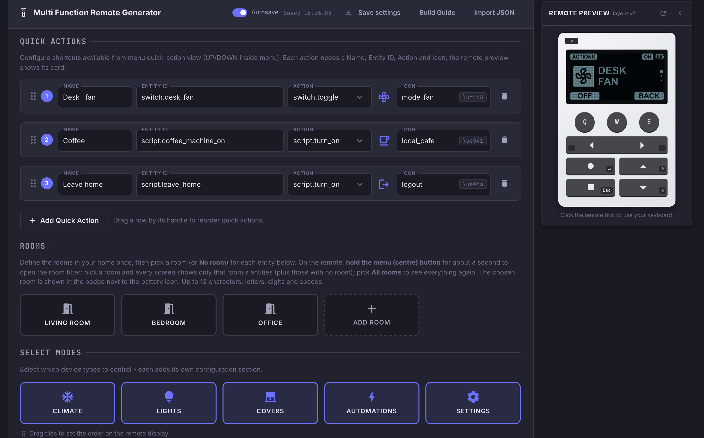](https://tech.lugowski.dev/tools/#multi)

**[Configure your remote online →](https://tech.lugowski.dev/tools/#multi)** Pick the modes, add your Home Assistant entities and quick actions, and watch every change on a live emulator of the remote. Then download a ready-to-build ESPHome project, WiFi or ESP-NOW. No YAML editing needed.

ESP32-based wireless remote with a 128×64 OLED display. Controls AC units, lights, covers, and automations via Home Assistant. All display and interaction logic lives in C++ header files under `src/`; ESPHome YAML handles connectivity, sensors, and button wiring.

Two firmware flavours share the same code: the original **WiFi remote** (`remote.yaml`, talks to Home Assistant directly) and the **ESP-NOW remote** (`remote_espnow.yaml`, talks to a small always-on hub for sub-second wake and much longer battery life). See [ESP-NOW variant](#esp-now-variant).

- Full project write-up: [tech.lugowski.dev/guides/smart-oled-remote](https://tech.lugowski.dev/guides/smart-oled-remote/)
- 3D-printed case: [MakerWorld](https://makerworld.com/en/models/1902607-home-assistant-esphome-remote-with-oled-display#profileId-2039332)
- ESPHome docs: [esphome.io](https://esphome.io/)

---

## Screenshots

The UI was redesigned in October 2026: same calm screens, but every screen now says where you are and works the same way. The write-up with the reasoning behind each decision is at [tech.lugowski.dev/projects/smart-oled-remote-ui](https://tech.lugowski.dev/projects/smart-oled-remote-ui/).

- **Context strip** on every screen: screen name, position dots (or `3/12` when they don't fit), the room, battery.
- **One navigation rule:** left / right moves between items, up / down changes the value. Quick actions are one press away from anywhere in the menu (up / down).
- **Soft buttons** over the round keys, like an ATM: a filled chip is a round key and says what it does on this screen; the outlined chip with three dots is the menu key.
- **Cards** for lights, covers and automations (lists still available), with a vertical slider for brightness and cover position.
- **Room filter:** hold the menu key to pick a room; entities without a room show everywhere.
- **Toasts** for a low battery and for a sent action; **Settings** one per page, editable values in a box with up / down arrows.

The images are rendered with the firmware's own layout and fonts.

### Menu and the screen it opens

| Menu | Screen | | |
|:---:|:---:|:---:|:---:|
| 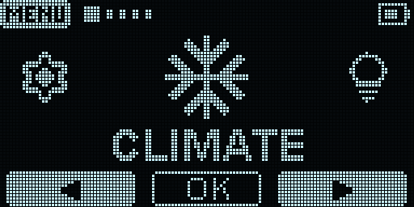 | 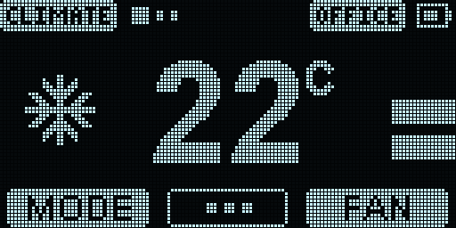 | 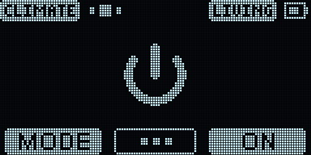 | 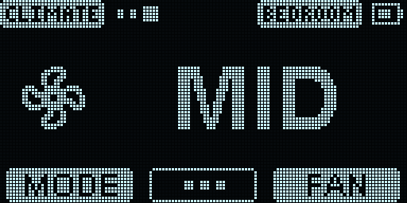 |
| Climate | cool / heat | off | fan only |
| 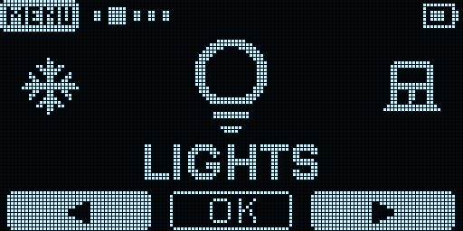 | 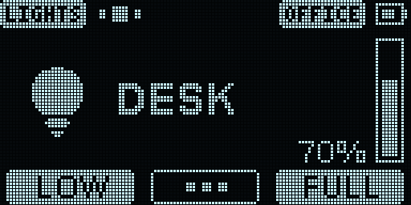 | 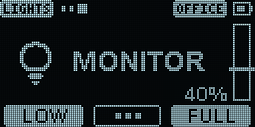 | 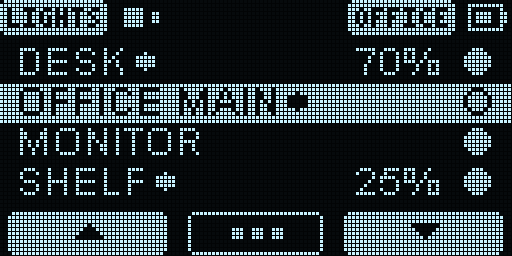 |
| Lights | card | card, light off | list |
| 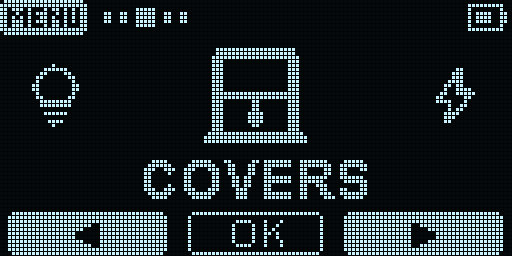 | 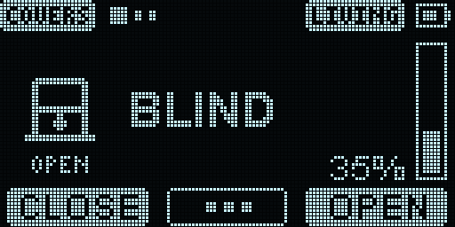 | 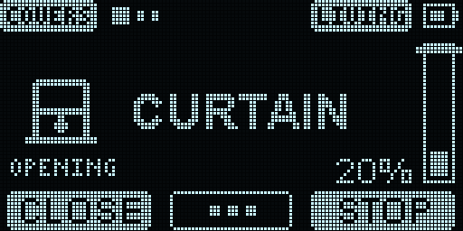 |  |
| Covers | at rest | opening to its target | |
| 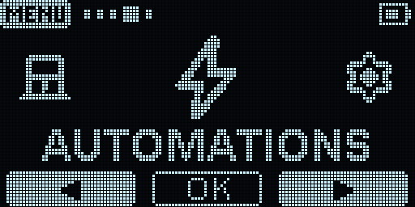 | 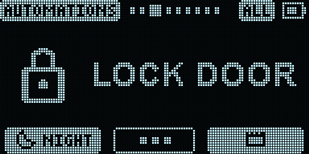 | 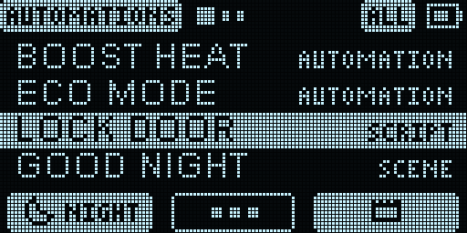 |  |
| Automations | card, two shortcut keys | list | |
| 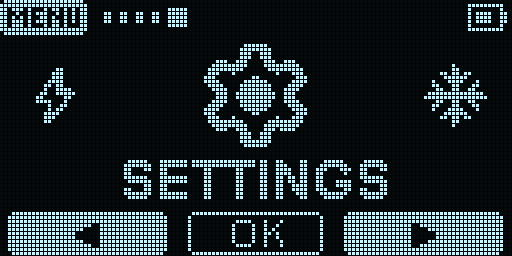 | 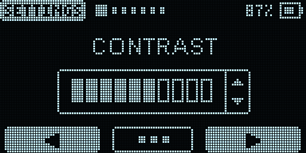 | 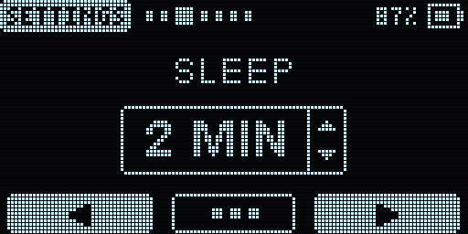 | 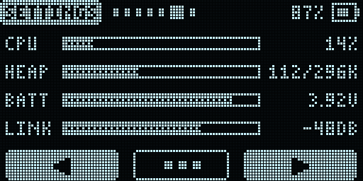 |
| Settings | contrast | sleep timeout | system |

### Quick actions and toasts

| Quick action (up / down in the menu) | Action sent | Low battery |
|:---:|:---:|:---:|
|  | 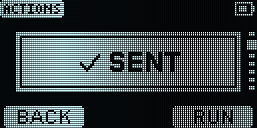 | 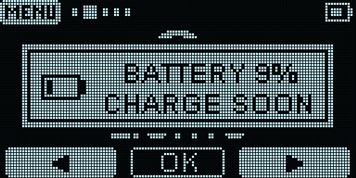 |

### Settings

| Contrast | Sleep timeout | Read-only value | System |
|:---:|:---:|:---:|:---:|
|  |  | 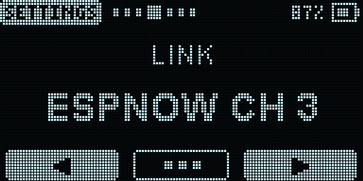 |  |

Left / right (and the round keys) move between settings, up / down changes the value in the box. Read-only values have no box.

### Room selection

| Hold the menu key | The room in the badge | Nothing in that room |
|:---:|:---:|:---:|
| 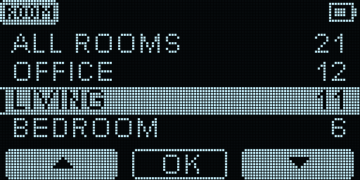 | 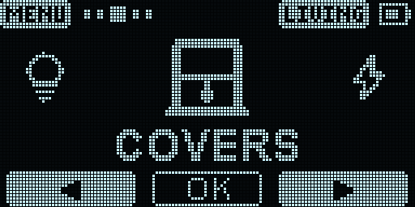 | 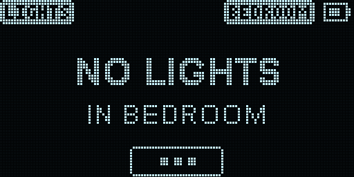 |

<details>
<summary>Previous UI (before October 2026)</summary>

| AC | Lights | Covers | Automations | Settings |
|:---:|:---:|:---:|:---:|:---:|
| 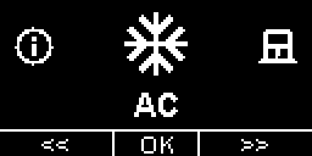 | 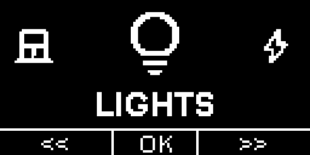 | 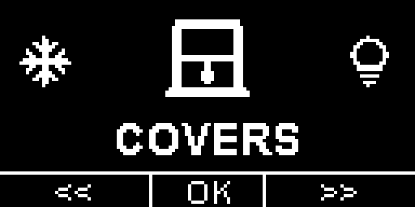 | 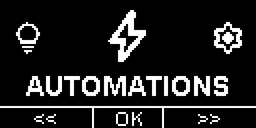 | 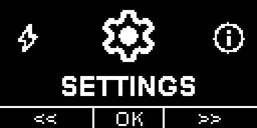 |
| 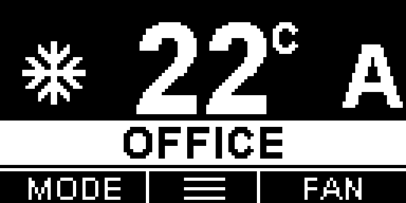 | 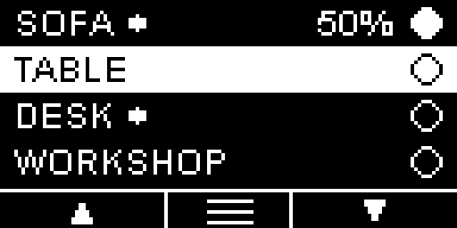 | 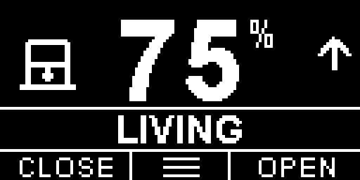 | 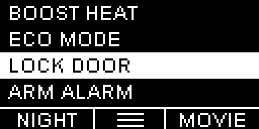 | 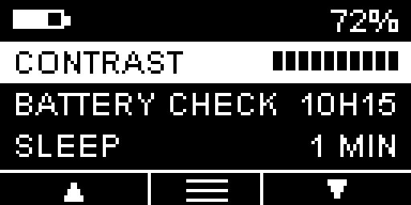 |
| 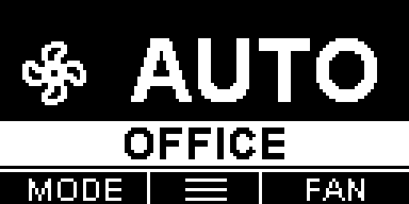 |  |  | | |
|  | 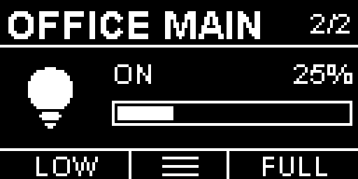 |  | | |

</details>

---

## Directory layout

```
esphome_remote/
├── README.md                           ← this file
├── tools/
│   └── screenshot.py                   ← OLED framebuffer → PNG converter
└── devices/
    ├── espnow_hub/                     ← ESP-NOW hub (always-on ESP32, bridges remotes ↔ HA)
    │   ├── hub.yaml                    ← hub firmware (reuses the remote's src/*_entities.h)
    │   └── components/remote_hub/      ← ESPHome external component (state cache + relay)
    ├── multi_function_remote/          ← current device (v2 hardware, 6-button pad)
    │   ├── remote.yaml                 ← production firmware, WiFi (edit substitutions at the top)
    │   ├── remote_espnow.yaml          ← production firmware, ESP-NOW (needs espnow_hub)
    │   ├── remote_demo.yaml            ← offline demo firmware (no HA/WiFi required)
    │   ├── secrets.yaml                ← WiFi credentials
    │   ├── Makefile                    ← CLI build targets
    │   ├── fonts/
    │   │   ├── arial.ttf                ← bundled into every generated config ZIP
    │   │   └── arial_bold.ttf           ← referenced by every font: entry in remote.yaml
    │   ├── packages/                   ← ESPHome YAML sub-packages (one per controller mode)
    │   │   ├── menu.yaml
    │   │   ├── mode_ac.yaml
    │   │   ├── mode_lights.yaml
    │   │   ├── mode_covers.yaml
    │   │   ├── mode_automations.yaml
    │   │   ├── mode_settings.yaml
    │   │   ├── buttons.yaml            ← abstract btn_* dispatcher (v2 layout)
    │   │   ├── espnow/                 ← ESP-NOW counterparts of the mode packages
    │   │   │   ├── transport.yaml      ← HELLO / channel scan / command sending
    │   │   │   └── mode_*.yaml         ← same scripts, state from hub instead of HA
    │   │   └── layouts/
    │   │       ├── layout_v1.yaml      ← original AC board pinout (self-contained)
    │   │       └── layout_v2.yaml      ← 6-button generic layout (default)
    │   └── src/                        ← C++ controller classes and entity lists
    │       ├── menu_entities.h         ← ★ configure menu order / enabled controllers
    │       ├── ac_entities.h           ← ★ configure AC units
    │       ├── light_entities.h        ← ★ configure lights
    │       ├── cover_entities.h        ← ★ configure covers
    │       ├── automation_entities.h   ← ★ configure automations
    │       ├── *_controller.h          ← logic for each mode (no need to be modified!)
    │       ├── espnow_protocol.h       ← packet format shared by remote and hub
    │       ├── espnow_remote.h         ← remote-side packet ↔ controller glue
    │       ├── display_utils.h
    │       └── remote_core.h
    └── oled_remote/                    ← legacy device (v1 hardware, original AC board)
        └── README.md                   ← legacy notes
```

Files marked ★ are the ones you edit to match your Home Assistant setup.

---

## Hardware

| Component | Spec |
|---|---|
| MCU | ESP32 (`esp32dev`) |
| Display | SH1106 128×64 OLED, I2C |
| I2C pins | SDA GPIO27 · SCL GPIO25 |
| Wake pin | GPIO0 |
| Button pad | 6-button directional pad (v2) or original layout (v1) |
| Battery | LiPo with 100 kΩ/100 kΩ voltage divider on GPIO34 |

---

## Button layouts

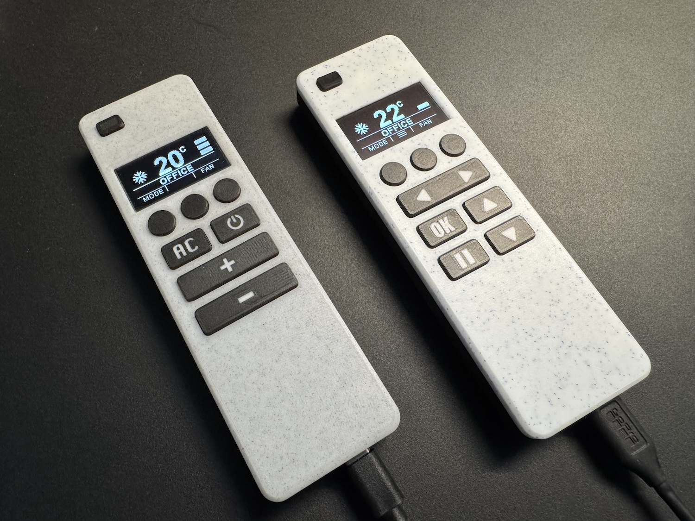

| | v1 (left) | v2 (right) |
|---|---|---|
| **Buttons** | AC, Power, +, − | ↑ ↓ ← → ● ■ |
| **Use case** | AC-only | Multi-mode (AC, lights, covers, automations) |
| **Layout file** | `layouts/layout_v1.yaml` | `layouts/layout_v2.yaml` _(default)_ |

Swap the `layout:` package line in `remote.yaml` to match your hardware revision.

---

## Getting started

### 1. WiFi credentials

Fill in `devices/multi_function_remote/secrets.yaml`:

```yaml
wifi_ssid: "YourSSID"
wifi_password: "YourPassword"
```

### 2. API encryption key

ESPHome uses a 32-byte base64 key (not a HA long-lived access token) to secure the native API. Each device should have its own unique key.

Generate one:

```bash
python3 -c "import os, base64; print(base64.b64encode(os.urandom(32)).decode())"
```

Add it to `devices/multi_function_remote/secrets.yaml` (`remote.yaml` reads it via `!secret api_key`, so the key itself never has to touch a file you might share for support):

```yaml
api_key: "paste_your_base64_key_here"
```

After flashing, HA will auto-discover the device. Go to **Settings → Devices & Services → ESPHome → Configure** and enter the same key — HA stores it for all future connections.

### 3. (Optional) Static IP, sleep mode, serial logs

`remote.yaml`'s `substitutions:` block has `USE_LIGHT_SLEEP` — the generator's "Light Sleep" toggle sets it `"true"` (default `"false"`, Deep Sleep). Deep Sleep deep-sleeps on the idle timeout and reboots (WiFi/API reconnect) on every wake; Light Sleep only blanks the display on that same timeout — WiFi and the API connection stay up, so the next press is instant with no reboot — and falls back to a real deep sleep after `DEEP_SLEEP_FALLBACK_MIN` (default 60) minutes of continued inactivity as a safety net. `WIFI_POWER_SAVE_MODE` (`LIGHT`/`NONE`) also moves with the toggle — `NONE` for Light Sleep keeps the radio fully powered for maximum responsiveness while connected. Edit these by hand if you're building straight from this repo instead of the generator.

Light Sleep is purely the software strategy above (blank display, WiFi/API stay associated) — the CPU stays at full clock the whole time. `CONFIG_PM_ENABLE`/tickless idle was tried for real automatic light sleep and reverted: on real hardware it destabilized WiFi/API and crashed (StoreProhibited) when combined with `deep_sleep`, so `esp32.framework.sdkconfig_options` no longer sets it.

For a static IP, add a `manual_ip:` block under `wifi:` in `remote.yaml` (values from `secrets.yaml`, not hardcoded — see the comment already there) and `mdns: { disabled: true }` at the top level; DHCP/mDNS is the default when neither is set.

`logger:` uses `baud_rate: ${LOGGER_BAUD_RATE}`, which defaults to `0` (no UART output — nothing to power on a device with no console attached). The generator's "Enable debug logging (UART)" toggle sets it to `115200`; edit `LOGGER_BAUD_RATE` by hand if you're building straight from this repo instead. `make logs-ota`/`esphome logs --device <ip>` still work at `baud_rate: 0` since remote logging goes over the API, not the UART — a real baud rate is only needed for USB-serial development logs or `tools/screenshot.py`'s serial capture (see below).

### 4. Configure your entities

Edit the `src/*_entities.h` files to match your Home Assistant setup (see [Entity configuration](#entity-configuration) below).

### 5. Flash the device

See [Building and flashing](#building-and-flashing) below.

---

## Building and flashing

### One-time setup

```bash
# Python 3.10+ required
python3 -m venv esphome-venv
source esphome-venv/bin/activate
pip install esphome

# Verify
esphome version
```

If `esphome` is not on your `$PATH`, edit the `ESPHOME` variable at the top of `Makefile`.

### Common commands

All `make` targets run from the `devices/multi_function_remote/` directory.

| Command | What it does |
|---|---|
| `make` | Compile production firmware |
| `make demo` | Compile demo firmware (no HA needed) |
| `make flash` | Compile + flash over USB (auto-detects port) |
| `make flash PORT=/dev/cu.usbserial-XXXX` | Flash to a specific USB port |
| `make ota IP=192.168.1.42` | Compile + flash over WiFi (OTA) |
| `make logs` | Open serial monitor |
| `make logs-ota IP=192.168.1.42` | Stream logs over WiFi |
| `make clean` | Remove build artefacts |
| `make espnow` / `make flash-espnow` | Compile / flash the ESP-NOW remote (USB only, no OTA) |
| `make hub` / `make flash-hub` / `make ota-hub IP=…` | Compile / flash the ESP-NOW hub |
| `make logs-espnow` / `make logs-hub IP=…` | Serial monitor for the ESP-NOW remote / hub logs over WiFi |

### First flash (USB)

Hold the **BOOT** button while pressing **RESET** to enter flash mode, then:

```bash
cd devices/multi_function_remote
make flash
# or with an explicit port:
make flash PORT=/dev/cu.usbserial-0001
```

After the first flash, subsequent updates can be done wirelessly:

```bash
make ota IP=<device-ip>
```

### Via Home Assistant ESPHome dashboard

1. Copy the `multi_function_remote/` folder into `/config/esphome/` on your HA instance:
   ```bash
   rsync -av devices/multi_function_remote/ ha:/config/esphome/multi_function_remote/
   ```
2. In the ESPHome dashboard click **+ New device → Import from file** and point it at `remote.yaml`.
3. Fill in `secrets.yaml` (`wifi_ssid`, `wifi_password`, `api_key`).
4. Hit **Install**.

---

## Taking screenshots

All firmwares can dump the current OLED framebuffer as hex lines over the logger, which `tools/screenshot.py` converts to a monochromatic PNG.

### Trigger

**Demo firmware** (`remote_demo.yaml`, always logs over serial — no toggle needed): while the device is connected over USB, navigate to the screen you want to capture and **hold the ■ stop button for 3 seconds**. The device logs the raw framebuffer (1024 bytes, 128×64) as hex lines and immediately returns to normal operation.

**Product firmware** (`remote.yaml`, generator-built): press the **Screenshot** button — it's a plain HA button entity (no `internal:` flag), so it shows up under the device in Home Assistant automatically and can be pressed there, called from an automation/script (`button.press`), or pressed on demand from the ESPHome dashboard. To capture the output over USB serial (rather than just watching HA's log viewer), turn on the generator's **"Enable debug logging (UART)"** toggle first — the raw hex lines only reach the serial port when `LOGGER_BAUD_RATE` is a real baud rate, not the power-optimized default of `0`.

**ESP-NOW firmware** (`remote_espnow.yaml`): the remote has no Home Assistant connection, so the button lives on the hub — press **Remote Screenshot** on the hub device in HA. If the remote is awake it answers within about a second; if it is asleep (its radio doesn't acknowledge the request), the hub logs `Remote is asleep, screenshot will be taken on its next wake` and sends the request again when the remote next wakes or sends a command. The remote sends its framebuffer to the hub over ESP-NOW and the **hub** logs it, so capture the hub's log (USB serial or over WiFi, below), not the remote's. Flash the hub and the remote together after updating, since both need the new protocol packets.

### Capture and convert

```bash
# Install dependencies (one-time)
pip install pyserial pillow

# Live mode — stays connected, saves screenshot_<timestamp>.png on every capture
python3 tools/screenshot.py /dev/tty.usbserial-XXXX

# Live mode from any log stream on stdin — e.g. the ESP-NOW hub over WiFi
# (PYTHONUNBUFFERED stops esphome from holding the log back when piped)
PYTHONUNBUFFERED=1 esphome logs devices/espnow_hub/hub.yaml | python3 tools/screenshot.py -

# Or parse a previously saved serial log (single capture, then exit)
python3 tools/screenshot.py --file dump.log

# Custom upscale factor (default: 4× → 512×256 px)
python3 tools/screenshot.py /dev/tty.usbserial-XXXX --scale 6
```

### Options

| Flag | Default | Description |
|---|---|---|
| `--file / -f` | — | Parse a saved log file instead of opening a serial port (single capture, then exit) |
| `--baud / -b` | `115200` | Serial baud rate |
| `--output / -o` | `screenshot_<ts>.png` | Output path (file mode only; live mode always uses the timestamp name) |
| `--scale / -s` | `4` | Pixel upscale factor (4 → 512×256 px) |

---

## Enabling and disabling controllers

Open `src/menu_entities.h`. The `MENU_LIST` array controls which controllers appear in the carousel and in what order:

```cpp
static const MenuEntry MENU_LIST[] = {
  { APP_AC,          "\ueb3b", "AC"          },
  { APP_COVERS,      "\uec12", "COVERS"       },
  { APP_LIGHTS,      "\ue0f0", "LIGHTS"       },
  { APP_AUTOMATIONS, "\uea0b", "AUTOMATIONS"  },
  { APP_SETTINGS,    "\ue8b8", "SETTINGS"     },
};
```

- **Remove a row** — that controller disappears from the carousel. Its button handlers stay silent (`app_mode == APP_X` can never be reached).
- **Reorder rows** — carousel order changes; routing follows automatically.
- **Single controller** — the menu button is suppressed (nothing to switch to).

The `APP_*` constants are stable — YAML conditions never need changing regardless of which controllers are enabled.

---

## Entity configuration

### AC (`src/ac_entities.h`)

One entry per physical air-conditioner unit.

```cpp
static const char* AC_MODES_0[] = { "cool", "fan_only" };
static const char* AC_FAN_0[]   = { "low", "high" };

static const ACEntity AC_LIST[] = {
  {
    "Living",                    // display name (≤8 chars)
    "climate.living_room_ac",    // HA entity_id
    "living_room_ac_temp",       // ESPHome sensor id — current temperature
    "living_room_ac_mode",       // ESPHome text_sensor id — hvac_mode
    "living_room_fan_mode",      // ESPHome text_sensor id — fan_mode
    AC_MODES_0, 2,               // modes array + count
    AC_FAN_0, 2                  // fan_modes array + count
  },
  // add more units…
};
```

The sensor `id:` values must match entries in `packages/mode_ac.yaml`.
Supported modes: `cool`, `heat`, `dry`, `fan_only`, `heat_cool`, `off`.

### Lights (`src/light_entities.h`)

One entry per light or light group.

```cpp
static const LightEntity LIGHTS_LIST[] = {
  //  name      entity_id        state_sensor_id   brightness_sensor_id  dimmable
  { "Sofa",  "light.sofa",   "sofa_light",      "sofa_brightness",    true  },
  { "Table", "light.table",  "table_light",     nullptr,              false },
};
```

Set `dimmable: true` and provide a `brightness_sensor_id` for lights that support brightness. Use `nullptr` for on/off-only lights.

### Covers (`src/cover_entities.h`)

One entry per cover (blind, curtain, roller shutter, etc.).

```cpp
static const CoverEntity COVER_LIST[] = {
  //  name       entity_id                    state_sensor_id         position_sensor_id
  { "Living", "cover.living_room_curtain", "living_curtain_state", "living_curtain_pos" },
};
```

- `state_sensor_id` — text_sensor: `open`, `closed`, `opening`, `closing`, or `stopped`
- `position_sensor_id` — sensor: 0–100 % (0 = fully closed, 100 = fully open)

Both must match entries in `packages/mode_covers.yaml`.

### Automations (`src/automation_entities.h`)

One entry per automation, scene, script, or any triggerable HA entity.

```cpp
static const AutomationEntity AUTOMATION_LIST[] = {
  //  name           short    entity_id                service                slot
  { "Good Night", "NIGHT", "scene.good_night",     "scene.turn_on",      "L"     },
  { "Movie Time", "MOVIE", "scene.movie_time",     "scene.turn_on",      "R"     },
  { "Away Mode",  "AWAY",  "automation.away_mode", "automation.trigger", nullptr },
};
```

- `service` — HA service to call (`scene.turn_on`, `automation.trigger`, `script.turn_on`, etc.)
- `slot` — `"L"` or `"R"` pins the entry as a one-press bottom-bar shortcut; `nullptr` for list-only
- `short_name` — bottom-bar label for slotted entries (≤5 chars)

---

## ESP-NOW variant

The WiFi remote has to boot, associate with WiFi, open the Home Assistant API connection and wait for entity states on every wake. That takes several seconds and costs battery. The ESP-NOW variant moves all of that to a small always-on **hub**:

```
 ┌──────────────┐  ESP-NOW (no WiFi association)  ┌─────────────┐  WiFi + native API  ┌────────────────┐
 │ Remote(s)    │ ───── HELLO / CMD / BATTERY ───▶ │ espnow_hub  │ ◀─────────────────▶ │ Home Assistant │
 │ deep sleep   │ ◀──── STATE_* snapshot ───────── │ state cache │                     │                │
 └──────────────┘                                  └─────────────┘                     └────────────────┘
```

- **Wake**: the remote broadcasts `HELLO`; the hub answers from its cache with the full state within a few milliseconds and the UI draws. No WiFi stack is started on the remote.
- **Commands**: every button action becomes one small `CMD` packet; the hub turns it into the Home Assistant service call.
- **Live updates**: while the remote is awake the hub broadcasts changes, so external changes still show up.
- **Sleep**: idle timeout defaults to 1 minute (Settings → SLEEP). Timer wakes only send a `BATTERY` packet and go back to sleep; the hub exposes it as `sensor.remote_battery`.
- **Several remotes** can share one hub.

The remote-side code is the same as the WiFi remote: all `src/*_controller.h` logic, the menu, button layouts and the `src/*_entities.h` lists are reused unchanged. Only the transport differs (`packages/espnow/`).

### Hub setup (`devices/espnow_hub/`)

1. Any ESP32 board on permanent power.
2. `secrets.yaml` → WiFi credentials, `hub.yaml` → `API_KEY` and `NETWORK_KEY` (any `uint32`, shared with the remote; it keeps other ESP-NOW traffic from being interpreted).
3. Flash: `make flash-hub` from `devices/multi_function_remote/`, later `make ota-hub IP=…`.
4. Add the hub to Home Assistant like any ESPHome device. It exposes *Remote Battery*, *Remote Battery Voltage*, *Last Remote* (MAC of the last remote that talked) and a *Resync Remotes* button.

The hub includes the **same** `src/*_entities.h` files as the remote, so entities are configured once. Entity indices are what travel over the air: rebuild and flash **both** the hub and the remote(s) after changing a list.

### Remote setup (`remote_espnow.yaml`)

1. `NETWORK_KEY` → same value as the hub.
2. `ESPNOW_CHANNEL` → your router's 2.4 GHz channel. This is only the first guess: the remote remembers the channel on which the hub last answered and scans all 13 channels if it gets no reply (about 250 ms per channel). Pin the router to a fixed channel for the fastest wake.
3. Flash over USB: `make flash-espnow`. There is no OTA without WiFi.

On the Settings screen the two network rows show `ESPNOW CH <n>` and the hub's MAC (or `NO HUB`). If the hub cannot be reached the remote shows **NO HUB** and retries every 5 seconds.

### Protocol

Documented in `src/espnow_protocol.h`. Every packet starts with `R N <version> <type> <key>`; state packets carry per-entity records (index + values), commands carry `domain / index / action / value`. Packets are plain ESP-NOW frames, so treat the key as a filter, not as encryption.

---

## Troubleshooting

**Device won't connect to WiFi**
- Verify credentials in `secrets.yaml`
- Try increasing `output_power` in `remote.yaml`

**Display not working**
- Check SDA/SCL wiring (GPIO27/GPIO25)
- Verify the display model (`SH1106` vs `SSD1306`) and I2C address (`0x3C`)

**Buttons not responding**
- Check pin assignments match your hardware revision (v1 vs v2 layout)
- Pins use internal pull-ups — button should connect GPIO to GND

**ESP-NOW remote shows NO HUB**
- Hub powered and connected to WiFi? (`make logs-hub IP=…`)
- `NETWORK_KEY` identical on both sides
- The remote scans all channels; a hub on a 5 GHz-only network cannot be reached (ESP-NOW is 2.4 GHz)

**ESP-NOW remote shows stale or missing entity state**
- Both firmwares must be built from the same `src/*_entities.h`; reflash the hub after editing a list
- Press *Resync Remotes* on the hub (or wake the remote again)

**API connection fails after flashing**
- Make sure `api_key` in `secrets.yaml` matches what you entered in HA
- HA must be reachable from the ESP32 subnet

---

## Legacy device

The original single-purpose AC remote (`devices/oled_remote/`) uses a different board layout and an older single-file YAML approach. It is no longer actively developed.

→ See [`devices/oled_remote/README.md`](devices/oled_remote/README.md) for notes on that configuration.
